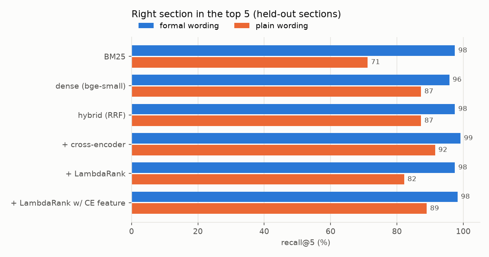
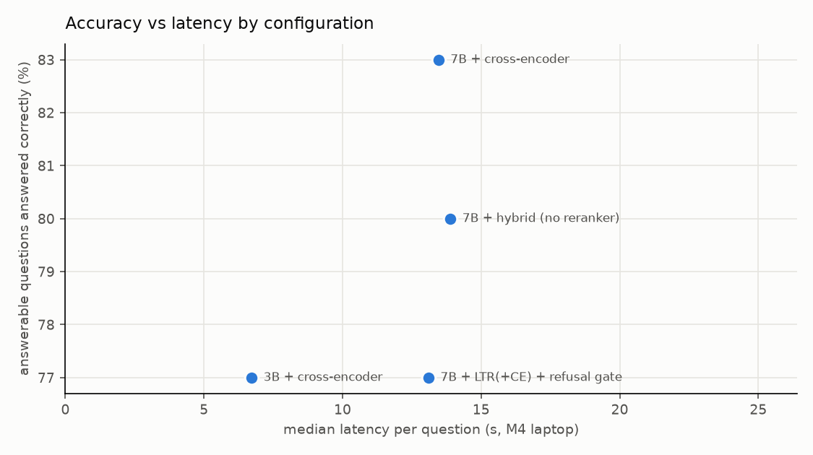

# cfr-benefits-assistant

**A grounded question-answering service over the regulations that decide veterans' disability and pension
claims, evaluated the way a production AI feature should be: per user group, with refusals, citations, latency and
cost.**

> Not affiliated with or endorsed by the U.S. Department of Veterans Affairs. The corpus is 38 CFR Parts 3–4 (public
> domain, from the eCFR API). Answers are general information, not legal advice.

Veterans ask questions like *"If my hearing is really bad at all frequencies, how do they decide my rating?"*; the
regulation says *"puretone threshold at 1000, 2000, 3000, and 4000 Hertz is 55 decibels or more"*. A search or RAG
system that works for the second phrasing and fails the first is failing the people it exists for. This project
builds the assistant end to end and measures exactly that.

- **Data pipeline.** eCFR XML (two table dialects, nested rating schedules) → 373 sections / 1,294 chunks in **DuckDB**,
  with a manifest of source hashes. CI rebuilds the corpus from the committed XML and checks it matches.
- **Retrieval + learning to rank.** BM25, dense embeddings (bge-small), hybrid reciprocal-rank fusion, an
  off-the-shelf cross-encoder, and a **LightGBM LambdaRank** reranker on 17 query–passage features (with and without
  the cross-encoder score as a feature).
- **Generation.** A local open-weights LLM (Qwen2.5 via MLX on Apple silicon, or any OpenAI-compatible endpoint in
  the Linux container) answers only from the retrieved sections, cites `[§3.304]`, and says when it can't find the
  answer. A calibrated retrieval-confidence gate can refuse *before* calling the model.
- **Guardrails.** Every citation must be one of the excerpts the model saw; uncited or ungrounded answers are
  flagged `needs_review`.
- **Evaluation.** 236 held-out questions (118 sections, each asked in regulatory language *and* in plain language),
  30 questions the regulations can't answer, 248 training questions from *different* sections for the ranker, and an
  end-to-end comparison of model size, reranker and gating on accuracy, citations, refusals, latency and tokens.
- **Service.** FastAPI (`/ask`, `/metrics`, `/drift`), query-drift monitoring (embedding MMD), rolling quality
  metrics, a Docker image, and CI with a retrieval regression gate.

---

## Results

### Retrieval: plain-language questions are the hard part

Share of questions whose source section is ranked first / in the top 5:

<!-- gen:retrieval -->
| retriever | formal: top-1 | formal: top-5 | **plain: top-1** | **plain: top-5** | plain MRR@10 |
|---|---|---|---|---|---|
| BM25 | 90 % | 98 % | 56 % | 71 % | 0.63 |
| dense embeddings (bge-small) | 86 % | 96 % | 60 % | 87 % | 0.72 |
| hybrid (reciprocal-rank fusion) | 91 % | 98 % | 64 % | 87 % | 0.74 |
| hybrid → cross-encoder (MiniLM) | 88 % | 99 % | 70 % | 92 % | 0.80 |
| hybrid → LambdaRank (LightGBM) | 92 % | 98 % | 64 % | 82 % | 0.72 |
| hybrid → LambdaRank + cross-encoder feature | 93 % | 98 % | 66 % | 89 % | 0.75 |

118 held-out sections, each asked two ways (236 questions). LambdaRank trained on 248 questions from different sections. Cross-encoder adds 299 ms per question (median, M4 CPU/GPU); first-stage retrieval takes 4 ms.
<!-- /gen:retrieval -->



- **Every method is near-perfect on regulation wording** (96–99 % top-5), so a benchmark built from formal questions
  alone would call this solved.
- **Plain language is where users get lost.** Top-1 accuracy falls from 86–93 % to 56–70 %. Keyword search is hit
  hardest (71 % top-5), because veterans don't use the regulation's words.
- **The learned reranker made plain language *worse*** (82 % vs 87 % top-5 for the hybrid it reranks). LambdaRank
  learned to trust keyword overlap, a strong signal for formal questions and a misleading one for plain ones, even
  though half its training questions were plain. The CI gate caught it (below). The off-the-shelf cross-encoder,
  which reads question and passage together, handles plain language best (92 %).

### Knowing when not to answer

The questions include 30 things these regulations don't cover (home loans, 2026 payment amounts, office phone numbers).
A gate on the top reranker score refuses before calling the LLM, which saves latency and tokens:

<!-- gen:refusal -->
| refusal gate on the top reranker score | AUROC (answerable vs not) | unanswerable refused | answerable wrongly refused |
|---|---|---|---|
| LambdaRank score | 0.80 | 13 % | 4 % |
| LambdaRank + cross-encoder score | 0.84 | 37 % | 8 % |
<!-- /gen:refusal -->

The threshold is the 5th percentile of top scores on answerable *training* questions, scored **out of fold**. The
first version calibrated on in-sample scores; that ranker had seen those questions, so its scores were inflated and
the gate refused 29 % of answerable test questions instead of about 5 %. A retrieval-score gate alone catches only a
third of the unanswerable questions, so the prompt also tells the model to refuse; the end-to-end table measures both.

### End to end

<!-- gen:answers -->
| configuration | answered correctly | cites the right section | citations grounded | unanswerable refused | answerable wrongly refused | needs review | p50 / p95 latency | tokens / question |
|---|---|---|---|---|---|---|---|---|
| 3B + cross-encoder | **77 %** | 70 % | 95 % | 77 % | 4 % | 16 % | 6.7 s / 9.1 s | 1461 |
| 7B + LTR(+CE) + refusal gate | **77 %** | 85 % | 98 % | 83 % | 13 % | 2 % | 13.1 s / 17.9 s | 1139 |
| 7B + cross-encoder | **83 %** | 87 % | 98 % | 93 % | 3 % | 2 % | 13.5 s / 18.2 s | 1454 |
| 7B + hybrid (no reranker) | **80 %** | 86 % | 97 % | 87 % | 2 % | 4 % | 13.9 s / 19.2 s | 1456 |

100 answerable questions (50 held-out sections × 2 wordings) + 30 unanswerable. "Answered correctly" counts a refused answerable question as wrong.
<!-- /gen:answers -->

<!-- gen:judge -->
Judge sanity check on 50 questions: reference answers judged correct 100 %; another question's reference answer judged incorrect 100 %.
<!-- /gen:judge -->



By wording:

<!-- gen:answers_by_style -->
| configuration | formal: correct | plain: correct | gap |
|---|---|---|---|
| 3B + cross-encoder | 80 % | 74 % | +6 pt |
| 7B + LTR(+CE) + refusal gate | 82 % | 72 % | +10 pt |
| 7B + cross-encoder | 88 % | 78 % | +10 pt |
| 7B + hybrid (no reranker) | 78 % | 82 % | -4 pt |
<!-- /gen:answers_by_style -->

- **Best configuration: Qwen2.5-7B with cross-encoder reranking and no gate.** It answers 83 % of answerable
  questions correctly, cites the source section in 87 %, never cites a section it wasn't shown in 98 %, and **refuses
  93 % of the out-of-scope questions by itself** while refusing only 3 % of answerable ones. This is the service
  default.
- **The retrieval-confidence gate doesn't pay for itself here.** It saves about 22 % of tokens by skipping the LLM,
  but it blocked 13 % of answerable questions (77 % correct overall), and the model was already refusing well. It
  stays available (`CFR_RERANKER=ltr_ce CFR_GATE=1`) for settings where token cost dominates.
- **Reranking helps the model more than retrieval metrics suggest.** The cross-encoder raises correct answers from
  80 % to 83 % and out-of-scope refusals from 87 % to 93 %. With better passages, the model is more willing to say a
  question isn't covered.
- **The 3B model halves latency** (6.7 s vs 13.5 s median) for 6 points of accuracy, but 16 % of its answers are
  uncited or cite something it wasn't shown (`needs_review`), against 2 % for 7B. The citation check is what makes the
  smaller model's failures visible.
- **Plain-language questions still trail formal ones by about 10 points** with the best configuration (78 % vs 88 %).
  With 50 questions per wording, differences under about ±10 points are within sampling noise; the retrieval
  results above (236 questions) are the more reliable measure of the gap.

---

## How it's built

```
eCFR XML ──ingest──▶ DuckDB (sections, chunks) ──▶ BM25 + bge-small embeddings
                                                         │ hybrid RRF, top 50 per retriever
                                                         ▼
                     cross-encoder rerank of the hybrid top 30  (default)
                     | LightGBM LambdaRank on 17 features (+ cross-encoder score)
                                                         │ optional: top score < calibrated threshold ──▶ refuse, no LLM call
                                                         ▼
                        top 4 sections ──▶ LLM (MLX local | OpenAI-compatible) ──▶ answer with [§] citations
                                                         ▼
                        citation check (grounded? cited?) ──▶ needs_review flag, rolling metrics, drift monitor
```

- **Section-level relevance.** Chunks never cross a section boundary, so every chunk maps to exactly one citation,
  and retrieval is scored on whether the right *section* comes back.
- **No leakage.** Questions are split by section: the ranker never trains on a test section, and its early-stopping
  set is a further 20 % of the training sections.
- **The evaluation set** (`scripts/make_eval_set.py`) is generated by a local Qwen2.5-7B from a passage, then
  verified by a second call (answerable from the passage alone, no section numbers leaked). 30 % of candidates were
  rejected. Plain-language versions share 50 % of their content words with the source passage, against 68 % for the
  formal versions. The 30 unanswerable questions are hand-written.
- **The LLM judge** (same Qwen2.5-7B) is sanity-checked before use: it must accept the reference answer and reject
  another question's reference answer.

## Run it

```bash
python -m venv .venv && .venv/bin/pip install -r requirements-mac.txt   # Apple silicon (MLX backend)
./scripts/fix_libomp_macos.sh          # macOS without Homebrew: LightGBM reuses torch's libomp
make ingest evalset retrieval answers report
make serve
curl -s localhost:8000/ask -H 'content-type: application/json' \
     -d '{"question": "Can my spouse get both DIC and educational help at once?"}' | jq .
```

Linux / Docker, with any OpenAI-compatible LLM server:

```bash
docker build -t cfr-assistant .
docker run -p 8000:8000 -e CFR_LLM_BASE_URL=http://host:8001/v1 -e CFR_LLM_MODEL=qwen2.5-7b-instruct cfr-assistant
```

## Monitoring

- `GET /metrics`: rolling refusal rate, gate-refusal rate, needs-review rate, p95 latency over the last 500 answers.
- `POST /drift`: kernel MMD between recent questions' embeddings and a reference set (permutation p-value). A new
  topic in the news, or a different user population, shows up here before it shows up in complaints.
- CI's **retrieval regression gate** (`scripts/regression_gate.py`) fails the build if the shipped reranker (the
  cross-encoder) stops beating hybrid retrieval, if its plain-language top-5 recall falls below hybrid's, or if the
  optional gate's refusal AUROC drops below 0.80. Its first version checked plain LambdaRank, which failed (MRR 0.834
  vs 0.839, plain-language recall 82 % vs 87 %); that's how the keyword-overlap problem was found.

## Limitations

- **Synthetic questions.** Generated and verified by the same model family, one question per section. Real veterans'
  questions are messier: misspellings, several issues at once, emotional context. A sample of real (de-identified)
  queries is the next thing to evaluate on.
- **Two parts of one title.** Parts 3–4 cover compensation, pension and ratings. Much of what people ask about
  (health care, education, home loans, appeals procedure) lives elsewhere, and the assistant correctly refuses those.
- **The judge is the answering model's family** and was only sanity-checked, not validated against human labels.
  Citation correctness and refusal metrics don't depend on it.
- **Local 4-bit models on a laptop.** Latency and token counts are for an M4 MacBook; a served model on a GPU would be
  several times faster. The *relative* cost of each configuration is what transfers.
- **General information, not advice.** Rating decisions depend on evidence and on the whole record, and this tool
  shouldn't be presented to users as more than a guide to where the rules are.
